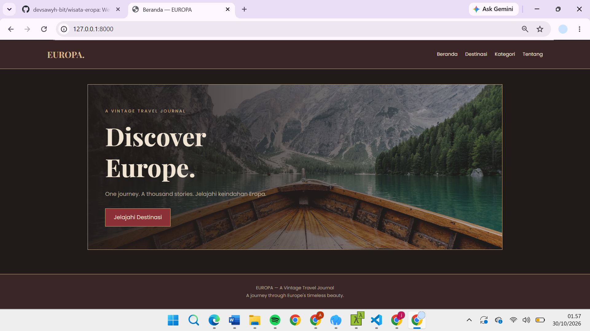
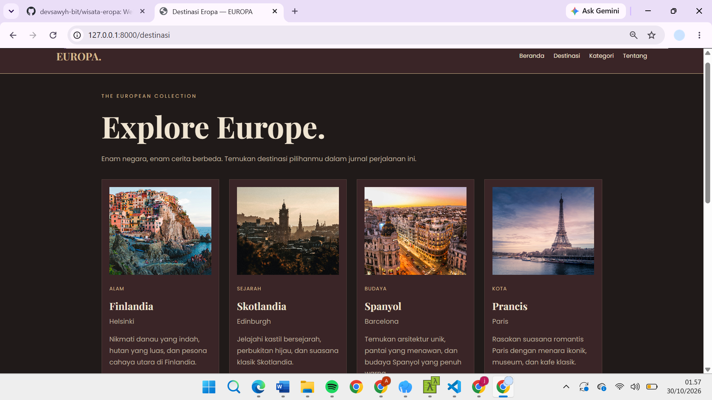
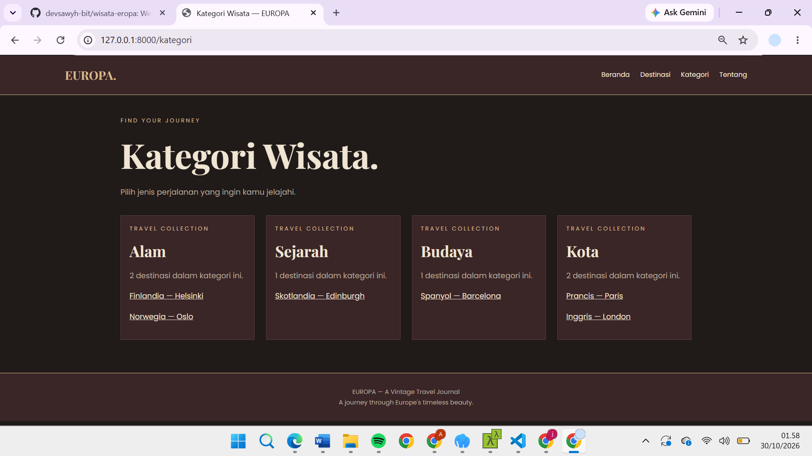
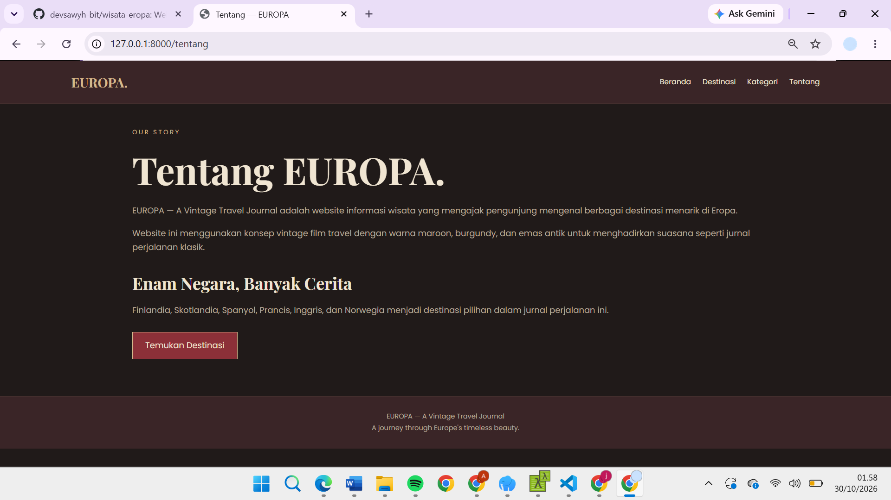
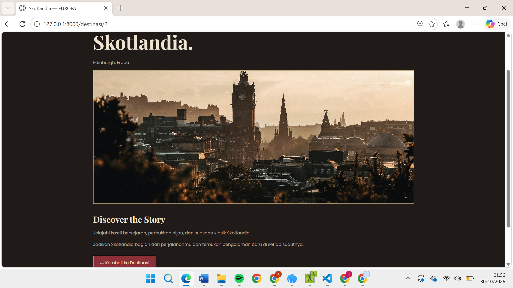

# EUROPA — Informasi Wisata Eropa

## Identitas Mahasiswa
- **Nama:** Deva Sayyidatul Adawiyah
- **NIM:** C2483207001
- **Kelas:** PTI5A
- **Tema:** Informasi Wisata
- **Judul Aplikasi:** EUROPA — Informasi Wisata Eropa

## Deskripsi Aplikasi
EUROPA adalah website informasi wisata negara-negara di Eropa yang dibuat menggunakan Laravel. Website ini menyajikan informasi destinasi, kota, kategori wisata, serta deskripsi singkat untuk membantu pengunjung mengenal berbagai tempat wisata di Eropa.

## Fitur Aplikasi
- Halaman Beranda
- Halaman Tentang Wisata
- Daftar Destinasi Wisata
- Kategori Wisata
- Detail Destinasi berdasarkan parameter URL
- Navigasi antarhalaman

## Destinasi Wisata
Website ini menampilkan enam destinasi:
1. Finlandia — Helsinki
2. Skotlandia — Edinburgh
3. Spanyol — Barcelona
4. Prancis — Paris
5. Inggris — London
6. Norwegia — Oslo

## Teknologi yang Digunakan
- PHP
- Laravel
- Blade Template
- HTML
- CSS

## Penjelasan Implementasi

### 1. Routing
Routing ditulis pada `routes/web.php`. Route menggunakan metode GET dan menghubungkan URL dengan method Controller yang sesuai. Salah satu route menggunakan parameter URL, yaitu `/destinasi/{id}`, untuk menampilkan detail destinasi berdasarkan ID.

### 2. Controller
Aplikasi menggunakan `HomeController` dan `WisataController`. Data enam destinasi disimpan sebagai array PHP di dalam Controller, kemudian dikirim ke View untuk ditampilkan. Controller memiliki beberapa method untuk halaman beranda, tentang, daftar destinasi, kategori, dan detail.

### 3. View dan Blade
Halaman dibuat menggunakan Blade Template. Layout utama menggunakan `@extends`, `@section`, dan `@yield`. Data ditampilkan dengan interpolasi Blade, sedangkan `@foreach` digunakan untuk menampilkan daftar destinasi.

### 4. Antarmuka
HTML dan CSS digunakan untuk membuat tampilan website dan navigasi antarhalaman. Website menyediakan halaman daftar dan detail destinasi yang mengambil parameter dari URL.

## Screenshot Aplikasi


## Screenshot Aplikasi

### 1. Halaman Beranda


### 2. Halaman List Destinasi


### 3. Halaman Kategori


### 4. Halaman Tentang


### 5. Halaman Deskripsi Destinasi


## Cara Menjalankan Proyek

1. Clone repository:

   ```bash
   git clone https://github.com/devsawyh-bit/wisata-eropa.git
   ```

2. Masuk ke folder proyek:

   ```bash
   cd wisata-eropa
   ```

3. Instal dependensi Laravel:

   ```bash
   composer install
   ```

4. Salin `.env.example` menjadi `.env`.

5. Buat application key:

   ```bash
   php artisan key:generate
   ```

6. Jalankan server lokal:

   ```bash
   php artisan serve
   ```

7. Buka `http://127.0.0.1:8000` di browser.

## Catatan
Data destinasi disimpan dalam array PHP di Controller. Aplikasi tidak menggunakan database, migration, Eloquent ORM, autentikasi, atau fitur CRUD.

## Repository GitHub
https://github.com/devsawyh-bit/wisata-eropa
